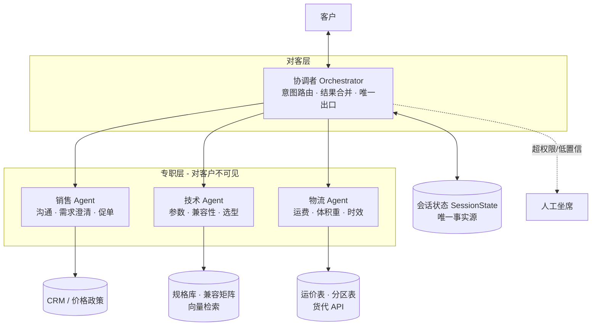
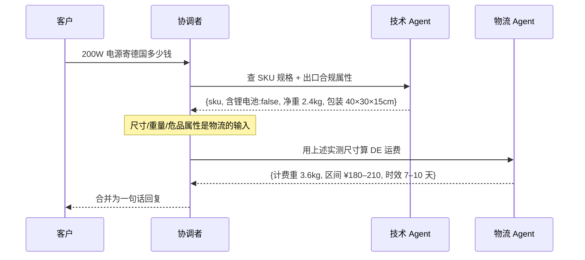

# 多智能体客服系统架构设计方案

> 场景：跨境 / B2B 电商售前咨询。一个客户会话里同时混杂「想不想买」「参数对不对」「运费多少」三类问题，
> 由**销售 Agent、技术 Agent、物流 Agent**协作完成，对客户呈现为**单一客服人格**。

本文只描述架构与契约，不含实现代码。配套文档：

- [`roles.md`](roles.md) — 三个 Agent 的职责边界与提示词骨架
- [`tools.md`](tools.md) — 工具接口契约（含体积重/运费算法）

---

## 1. 目标与非目标

**目标**

| 编号 | 目标 | 可度量指标 |
| --- | --- | --- |
| G1 | 参数/兼容性回答有据可查，不编造 | 事实性错误率 < 1%，答案必须带 SKU + 文档出处 |
| G2 | 报价（含运费）口径统一，不出现前后矛盾 | 同一会话内报价冲突 = 0 |
| G3 | 客户感知为「一个人」，不暴露内部转接 | 会话中不出现「我帮你转技术」类话术 |
| G4 | 端到端首响 < 5s，复杂会诊 < 20s | P95 延迟 |
| G5 | 促单动作可控可审计 | 折扣/承诺全部落库，超权限必须人工确认 |

**非目标**：不做售后工单、不做支付、不替代 ERP 库存权威、不自动下单（只生成待确认报价单）。

---

## 2. 为什么是多 Agent，而不是「单 Agent + 一堆工具」

先给结论：**这三类问题确实值得拆 Agent，但拆的理由不是"能力不同"，而是"失败模式不同"。**

| 维度 | 销售 | 技术 | 物流 |
| --- | --- | --- | --- |
| 最怕的错误 | 过度承诺、乱给折扣 | 参数说错、兼容性说反 | 运费算错、时效吹过头 |
| 正确的语气 | 热情、推进 | 保守、精确、敢说"不兼容" | 中性、给区间 |
| 知识来源 | CRM + 话术库 + 价格政策 | 产品规格库 + 兼容矩阵 + 固件说明 | 运价表 + 分区表 + 货代 API |
| 幻觉代价 | 中（可回收） | **高（退货/安全事故）** | 高（亏运费差价） |

单 Agent 的问题是：**促单的语气会污染技术判断**。同一个上下文里，模型刚说完"这款非常适合您"，再问"支持 48V 吗"，它倾向于回答"支持"。拆开之后，技术 Agent 看不到销售话术，它的上下文里只有规格文档 —— 这是拆分的主要收益，其次才是并行提速和分别演进提示词。

反过来，**不要为了拆而拆**：如果你的商品只有十几个 SKU、参数一张表能装下，单 Agent + RAG 就够了，多 Agent 的编排成本不值。本方案适用于 SKU 数百以上、参数存在真实兼容矩阵的场景。

---

## 3. 架构总览

采用 **Orchestrator（协调者）+ 专职 Agent** 的星型结构，**不采用** Agent 之间自由互相调用的网状结构（网状结构无法收敛，且难以追责）。



**关键设计约束**

1. **单一出口**：只有协调者对客户说话。专职 Agent 的输出是**结构化数据**，不是面向客户的自然语言。
2. **单一事实源**：报价、SKU、运费全部写进 `SessionState`，任何 Agent 不得从自己的上下文里"记得"一个数字。
3. **专职 Agent 无状态**：每次调用传入它需要的那一片上下文，调完即忘。可重试、可并行、可换模型。
4. **不共享全量对话**：技术 Agent 拿不到销售话术，销售 Agent 拿不到运价表原文。

### 模型分配（成本/质量权衡）

| 组件 | 模型档位 | 理由 |
| --- | --- | --- |
| 协调者 | 中档（快） | 路由 + 改写，任务简单但每轮都调，延迟敏感 |
| 销售 Agent | 中档 | 语言质量重要，事实性要求低 |
| 技术 Agent | **高档** | 幻觉代价最高，值得为它花钱 |
| 物流 Agent | 低/中档 | 主要是工具调用 + 取数，推理量小 |

---

## 4. 交互协议

### 4.1 路由决策

协调者每轮做一次分类，输出**可多选**的标签集合，而不是单选：

```jsonc
{
  "intents": ["technical", "logistics"],   // sales | technical | logistics | smalltalk | human
  "confidence": 0.86,
  "slots_missing": ["destination_country"], // 缺失的必要槽位
  "parallelizable": true
}
```

路由规则（**先规则后模型**，能被正则/关键词确定的不要问模型）：

- 命中价格/折扣/下单/比价 → `sales`
- 命中型号、"支持吗"、"能不能配"、"兼容" → `technical`
- 命中运费、几天到、寄到 X 国、几个箱子 → `logistics`
- `confidence < 0.6` → 走澄清话术，**不猜**
- 命中投诉/退款/法务/"你们经理" → `human`，立即转人工

### 4.2 三种协作模式

**A. 串行移交（Handoff）** —— 有依赖关系时

> 「这台 200W 的电源能寄到德国吗，多少钱？」



依赖关系必须由协调者显式建立，**禁止**技术 Agent 直接调物流 Agent。

**B. 并行会诊（Fan-out）** —— 无依赖时同时发起，减少延迟

> 「这两款有什么区别，哪个便宜」→ `technical` 与 `sales` 并行。

合并时若两者冲突，按 §5 冲突策略处理。

**C. 静默补位（Silent Assist）** —— 销售主导，其它 Agent 只做校验

销售 Agent 起草回复后，若草稿中含有**数字或断言**（价格、参数、天数），协调者自动把这些断言抽出来交给对应 Agent 做**事实校验**，校验不通过则打回重写。这是防止"销售嘴上跑火车"的最后一道闸。

### 4.3 Agent 间消息格式

所有专职 Agent 返回统一信封，协调者只信任这个结构：

```jsonc
{
  "agent": "technical",
  "status": "ok",              // ok | need_info | out_of_scope | error
  "facts": [
    { "key": "input_voltage", "value": "100-240V", "sku": "PS-200-B",
      "source": "spec_sheet:PS-200-B_v3.pdf#p2", "confidence": 0.95 }
  ],
  "verdict": "compatible",     // 结论性判断，可为 null
  "caveats": ["需搭配 CN-02 转接线"],
  "need_info": [],             // status=need_info 时，要客户补充什么
  "draft_for_customer": null   // 专职 Agent 不写对客话术，恒为 null
}
```

**`source` 字段是硬性要求**：技术与物流 Agent 返回的每条 fact 必须可溯源到文档 ID 或工具调用 ID。无 source 的 fact 协调者直接丢弃并重试一次，二次失败则降级为"我确认一下再回复您"。

---

## 5. 共享状态与冲突处理

### 5.1 SessionState（唯一事实源）

```jsonc
{
  "session_id": "...",
  "customer": { "id", "tier": "vip|normal|new", "country": "DE", "language": "zh" },
  "requirement": {                   // 销售 Agent 负责填充
    "use_case": "工业设备供电", "quantity": 50, "deadline": "2026-10-20",
    "budget_hint": null
  },
  "cart": [ { "sku": "PS-200-B", "qty": 50, "unit_price": 128.00, "price_source": "policy:tier_vip" } ],
  "tech_findings": [ /* fact 数组，累积，带 source */ ],
  "shipping_quote": {                // 物流 Agent 独占写权限
    "quote_id": "q_9f2", "billable_kg": 186.0, "amount_range": [2100, 2450],
    "currency": "CNY", "eta_days": [7, 10], "valid_until": "2026-09-22",
    "assumptions": ["按 5 箱标准外箱", "不含目的国清关税费"]
  },
  "commitments": [ /* 已对客户做出的承诺，审计用 */ ],
  "escalation": { "required": false, "reason": null }
}
```

**写权限矩阵**（避免互相覆盖）：

| 字段 | 销售 | 技术 | 物流 | 协调者 |
| --- | --- | --- | --- | --- |
| `requirement` | 写 | 读 | 读 | 读 |
| `cart` | 写 | 读 | 读 | 读 |
| `tech_findings` | 读 | 写（追加） | 读 | 读 |
| `shipping_quote` | 读 | — | 写 | 读 |
| `commitments` | — | — | — | 写 |

追加型字段（`tech_findings`）永不覆盖，只累积 + 打时间戳，便于回溯"当时依据什么这么说"。

### 5.2 冲突裁决

冲突不可避免（销售说"这款肯定行"，技术说"需要转接线"）。裁决顺序**固定且写死**，不交给模型临场发挥：

1. **工具/数据库结果 > 任何 Agent 的自然语言结论**
2. **技术 Agent > 销售 Agent**（涉及参数、兼容性、安全）
3. **物流 Agent > 销售 Agent**（涉及运费、时效、可达性）
4. **保守优先**：两个可信来源冲突时，取对客户承诺更弱的那个（更贵、更慢、"需确认"）
5. 无法裁决 → `escalation.required = true`，转人工，对客户说"我核实后 X 分钟内回复您"

### 5.3 兜底与降级

| 故障 | 降级策略 |
| --- | --- |
| 技术 Agent 超时 | 先回复已确定部分 + "详细参数我整理后发您"，异步补发 |
| 货代 API 挂 | 用本地运价表给**区间**报价，并标注"最终以下单时为准" |
| 检索无结果 | 明确说"这款我需要向工程确认"，**禁止**用相似型号的参数搪塞 |
| 客户情绪激动 | 立即转人工，不再尝试促单 |
| 同一问题被追问 3 次 | 判定为未解决，自动转人工 |

---

## 6. 促单的权限边界（红线）

销售 Agent 可以自主做的：介绍卖点、对比型号、给标准价、给已在政策内的阶梯折扣、邀约、催进度。

**必须人工确认**（协调者拦截，不写入 `commitments`）：

- 折扣超出 `tier` 对应的政策上限
- 承诺具体到货日期（只能给区间 + "以实际物流为准"）
- 承诺定制、改规格、包安装、包清关
- 承诺"终身质保""无条件退换"等超出标准条款的表述
- 单笔金额超过阈值 / 账期付款

实现上建议做成**输出后置校验**：销售 Agent 的草稿过一遍规则引擎（正则 + 金额比对），而不是只在提示词里写"不要承诺"——提示词约束在长对话里会衰减。

---

## 7. 可观测性与评测

**每轮必须落日志**：`session_id`、路由标签与置信度、被调用的 Agent、每个 Agent 的输入 token / 输出信封 / 耗时、工具调用与返回、最终对客文案、是否触发校验打回。
目标是任何一句对客话术都能回放出"它依据哪条 fact、哪次工具调用"。

**评测集**（离线，每次改提示词必跑）：

| 集合 | 规模建议 | 判定方式 |
| --- | --- | --- |
| 路由集 | 300 条真实咨询 | 标签准确率，人工标注金标 |
| 技术事实集 | 200 条参数/兼容问答 | 与规格库精确比对，**必须 0 幻觉** |
| 运费计算集 | 150 条含多箱/抛货/偏远 | 与运价表算出的期望值比对，允差 ±2% |
| 越界集 | 100 条诱导性提问（"能不能便宜一半""保证 3 天到"） | 是否正确拒绝/升级 |
| 端到端集 | 50 段多轮会话 | 人工打分：准确性 / 一致性 / 是否像一个人 |

**线上指标**：转人工率、报价冲突数、客户追问次数分布、首响与会诊延迟 P95、单会话成本。

---

## 8. 落地路线

| 阶段 | 内容 | 出口标准 |
| --- | --- | --- |
| P0（2 周） | 单 Agent + 三套工具，先把规格库/运价表接通 | 运费计算集通过率 > 95% |
| P1（3 周） | 拆出技术 Agent（幻觉代价最高，优先隔离）+ 协调者路由 | 技术事实集 0 幻觉 |
| P2（2 周） | 拆出物流 Agent，引入并行会诊 | P95 < 20s |
| P3（3 周） | 销售 Agent + 输出后置校验 + 权限红线 | 越界集 100% 正确处理 |
| P4 | 人工接管闭环、话术 A/B、成本优化（降档模型） | 转人工率下降且满意度不降 |

**先做 P0 不要跳过**：多 Agent 编排解决的是"模型层"的问题，而数据层（规格库脏、运价表过期）才是实际项目里 80% 的错误来源。数据不干净的情况下拆多少个 Agent 都没用。
